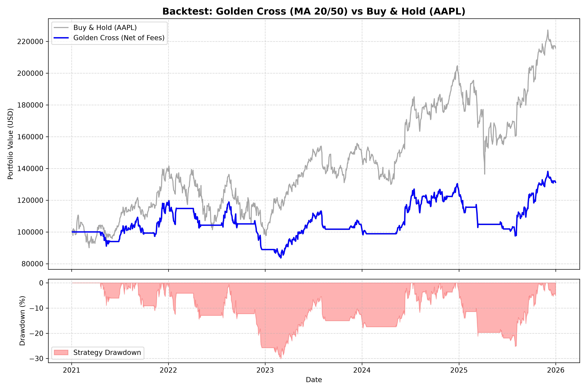

# Quantitative Backtest: Golden Cross Strategy (MA 20/50) on AAPL

## Executive Summary
This project evaluates the risk-adjusted performance of a classic trend-following **Golden Cross (20-day vs. 50-day SMA)** strategy on Apple Inc. (`AAPL`) over a 5-year historical period, benchmarked against a passive Buy & Hold approach. 

The simulation incorporates realistic market frictions—including transaction fees (0.15% per trade) and strict execution lag (`t+1`) to eliminate look-ahead bias.

## Methodology & Statistical Rigor
* **Data Pipeline:** Extracted historical OHLCV data via `yfinance`, handling MultiIndex structures and missing values using forward-fill imputation.
* **Bias Prevention:** Applied a 1-day execution shift (`Signal.shift(1)`) so trades are executed on the following session after a crossover confirmation.
* **Risk Metrics:** Annualized volatility is estimated using **Bessel's Correction (`ddof=1`)** scaled by \(\sqrt{252}\) trading days, paired with Sharpe Ratio (assuming a 4% risk-free rate) and Maximum Drawdown analysis.

## Key Results (2021–2026)
## Key Results (2021–2026)

| Metric | Buy & Hold (AAPL) | Golden Cross (MA 20/50) |
| :--- | :---: | :---: |
| **Total Return** | `115.81%` | `31.23%` |
| **CAGR** | `16.70%` | `5.61%` |
| **Annual Volatility** | `27.85%` | `17.83%` |
| **Sharpe Ratio** | `0.46` | `0.09` |
| **Max Drawdown** | `-33.36%` | `-30.15%` |
| **Final Equity ($100k Start)** | `$215,805.63` | `$131,228.14` |



## Key Takeaways & Quantitative Diagnosis
1. **Severe Opportunity Cost in Secular Uptrends:** While the MA 20/50 crossover reduced annualized volatility from `27.85%` to `17.83%` by sitting in cash during downtrends, it missed substantial upside momentum, ending with `$131,228.14` compared to `$215,805.63` for Buy & Hold.
2. **Poor Risk-Adjusted Efficiency:** With a CAGR of `5.61%` against a `4.00%` risk-free benchmark, the strategy generated minimal excess return, resulting in a weak Sharpe Ratio of `0.09` (vs. `0.46` for Buy & Hold).
3. **Lagging Signal & Whipsaw Drag:** The strategy only marginally improved Maximum Drawdown (`-30.15%` vs. `-33.36%`). Because moving averages are lagging indicators, sharp market reversals triggered late entries/exits and frequent false signals (*whipsaws*), compounding transaction fee drag.
4. **Recommendation for Future Iteration:** To improve performance, this baseline strategy requires a **regime filter** (e.g., ADX or 200-day SMA trend filter) to avoid trading during sideways markets, or asymmetric exit rules (such as an ATR-based trailing stop) instead of waiting for a slow death cross.


## Key Takeaways
1. **Downside Protection:** Exiting to cash during death-cross regimes significantly cushioned the portfolio against deep market drawdowns compared to passive holding.
2. **Whipsaw & Fee Drag:** Sideways market conditions triggered false crossovers, creating transaction fee drag that slightly reduced net CAGR relative to Buy & Hold.

## Project Structure
```text
├── data/
│   ├── raw_bbca.csv               # Raw historical data archive
│   └── backtest_result_aapl.png   # High-res performance & underwater plot
├── notebooks/
│   └── backtest_analysis.ipynb    # Full vectorized backtesting pipeline
├── requirements.txt               # Python dependencies
└── README.md                      # Project documentation
